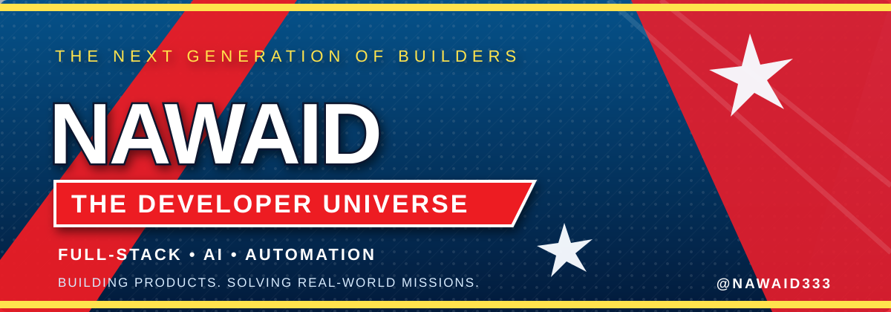

  <a href="#about">ABOUT</a> &nbsp;·&nbsp;
  <a href="#technology">TECHNOLOGY</a> &nbsp;·&nbsp;
  <a href="#selected-work">PROJECTS</a> &nbsp;·&nbsp;
  <a href="#github-activity">GITHUB ACTIVITY</a> &nbsp;·&nbsp;
  <a href="#contact">CONTACT</a>

---

## THE DEVELOPER UNIVERSE

<table>
<tr>
<td align="center" valign="top" width="20%">

<strong>THE ARMORED GENIUS</strong> 
System Engineering
</td>
<td align="center" valign="top" width="20%">

<strong>THE DARK SOVEREIGN</strong> 
Technical Strategy
</td>
<td align="center" valign="top" width="20%">

<strong>THE GREEN TITAN</strong> 
Problem Solving
</td>
<td align="center" valign="top" width="20%">

<strong>THE STORM WARRIOR</strong> 
Code & Deployment
</td>
<td align="center" valign="top" width="20%">

<strong>THE WEB ARCHITECT</strong> 
Web & Integration
</td>
</tr>
</table>

---

## About

<table>
<tr>
<td width="160" align="center" valign="top">

  
<strong><a href="https://github.com/nawaid333">@nawaid333</a></strong>
</td>
<td valign="top">

### Mohammad Nawaid Kalim

Full-stack developer focused on building practical software, AI-powered products and workflow automation.

I combine hands-on product development with experience in project coordination, operations and MIS reporting.

- Designing and developing full-stack applications
- Exploring AI agents, APIs and Model Context Protocol (MCP)
- Automating repetitive workflows and integrations
- Working with databases, debugging and deployment
- Turning operational problems into useful software tools

</td>
</tr>
</table>

## Technology

**Current focus:** AI Engineering · API Integration · MCP · Workflow Automation · Full-Stack Development

---

## Selected Work

<table>
<tr>
<td width="50%" valign="top">

### Nawshum
**AI Job Application Assistant**

AI-powered workflows for CV tailoring, job matching and application assistance.

AI · Automation · Next.js

[Repository](https://github.com/nawaid333/jobpilot-ai) · [Website](https://nawshum.com)

</td>
<td width="50%" valign="top">

### CV Analyzer
**AI-powered CV analysis**

Exploring automated CV analysis and ATS-oriented feedback using Python and Gemini.

Python · Gemini · ATS

[Explore repositories](https://github.com/nawaid333?tab=repositories)

</td>
</tr>
</table>

---

## GitHub Activity

---

## Contact

**Building practical products. Exploring intelligent systems. Improving every day.**

