

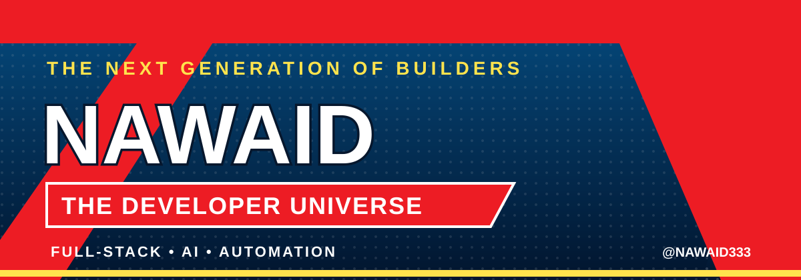

<h1>⚡ NAWAID // THE DEVELOPER UNIVERSE ⚡</h1>
<h3>ONE MIND. FIVE FORCES. LIMITLESS BUILDS.</h3>

<em>Every challenge has a weakness. Every problem has a solution. I build the tools to find it.</em>

<a href="#origin-story">ORIGIN STORY</a> ·
<a href="#the-five-forces">THE FIVE FORCES</a> ·
<a href="#arsenal">ARSENAL</a> ·
<a href="#missions">MISSIONS</a> ·
<a href="#battle-record">BATTLE RECORD</a> ·
<a href="#transmission">TRANSMISSION</a>

---

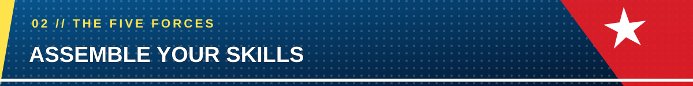

<em>Five original hero identities. One developer mindset.</em>

<table>
<tr>
<td align="center" width="33%" valign="top">
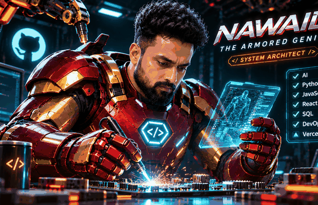
<h3>🔴 THE ARMORED GENIUS</h3>
<strong>THE SYSTEM BUILDER</strong> 
Engineering · Architecture · Debugging
</td>
<td align="center" width="33%" valign="top">
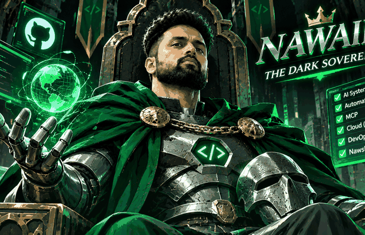
<h3>🟢 THE DARK SOVEREIGN</h3>
<strong>THE STRATEGIST</strong> 
Planning · Logic · Technical decisions
</td>
<td align="center" width="33%" valign="top">
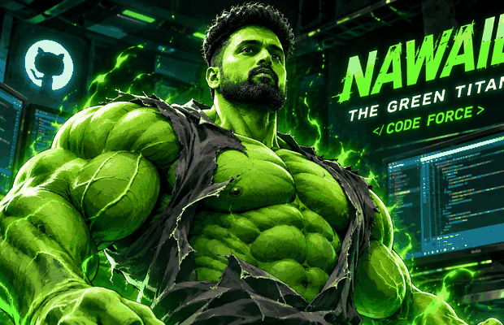
<h3>💚 THE GREEN TITAN</h3>
<strong>THE PROBLEM BREAKER</strong> 
Troubleshooting · Persistence · Optimization
</td>
</tr>
<tr>
<td align="center" width="33%" valign="top">
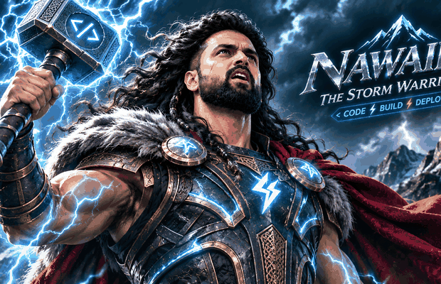
<h3>⚡ THE STORM WARRIOR</h3>
<strong>THE DEPLOYMENT FORCE</strong> 
Code · APIs · Cloud deployment
</td>
<td align="center" width="33%" valign="top">
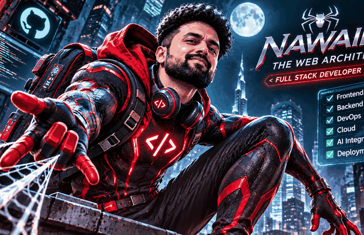
<h3>🕸️ THE WEB ARCHITECT</h3>
<strong>THE CONNECTOR</strong> 
Web apps · Integrations · Automation
</td>
<td align="center" valign="middle">
<h2>THE MISSION</h2>

<strong>Turn complex problems into useful technology.</strong>

Build with purpose. Learn without limits.
</td>
</tr>
</table>

---

<table>
<tr>
<td width="180" align="center" valign="top">

  
<strong>NAWAID</strong> 
<a href="https://github.com/nawaid333">@nawaid333</a>
</td>
<td valign="top">

### Mohammad Nawaid Kalim
**Full-Stack Developer | AI & Automation Explorer**

I’m driven by one idea: technology should solve real problems.

I build practical software, explore AI-powered products and connect tools through APIs and automation. My background in project coordination, operations and MIS reporting helps me understand the real-world problems behind the systems.

**MY CORE DIRECTIVES**
- Build full-stack applications and useful digital products
- Explore AI agents, APIs and Model Context Protocol (MCP)
- Automate repetitive workflows and connect services
- Work with databases, debugging and deployment
- Bring operational thinking into software development

</td>
</tr>
</table>

---

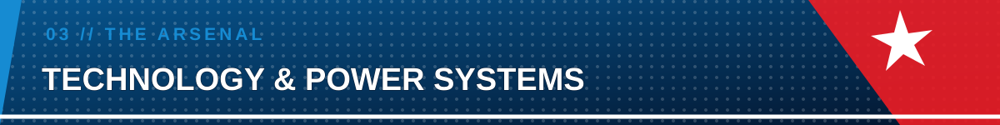

<em>Tools are the weapons. Skill is knowing when and how to use them.</em>

---

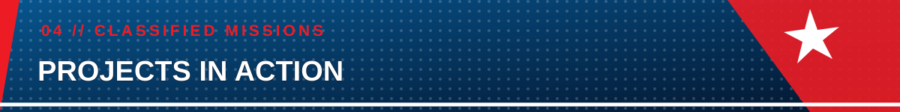

<table>
<tr>
<td width="50%" valign="top">

<h3>🧠 MISSION 01 — NAWSHUM</h3>
<strong>AI JOB APPLICATION ASSISTANT</strong>

An AI-powered product concept designed to help job seekers tailor CVs, discover relevant opportunities and streamline application workflows.

<code>AI</code> <code>Automation</code> <code>Next.js</code>

<a href="https://github.com/nawaid333/jobpilot-ai">↗ ACCESS REPOSITORY</a> 
<a href="https://nawshum.com">↗ VISIT NAWSHUM</a>

</td>
<td width="50%" valign="top">

<h3>📄 MISSION 02 — CV ANALYZER</h3>
<strong>AI-POWERED CV ANALYSIS</strong>

Exploring automated CV analysis and ATS-oriented feedback to make resumes clearer and more relevant to job requirements.

<code>Python</code> <code>Gemini</code> <code>ATS</code>

<a href="https://github.com/nawaid333?tab=repositories">↗ EXPLORE REPOSITORIES</a>

</td>
</tr>
</table>

---

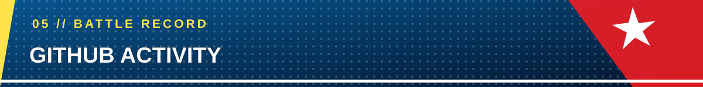

<em>Every commit is progress. Every project is another mission completed.</em>

---

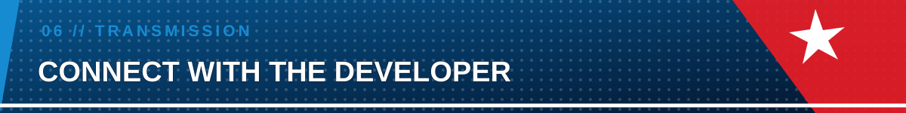

<strong>HAVE A CHALLENGE WORTH BUILDING?</strong>

Let’s turn bold ideas into working technology.

<h3>⚡ CODE. BUILD. DEPLOY. REPEAT. ⚡</h3>
NAWAID // END OF TRANSMISSION

