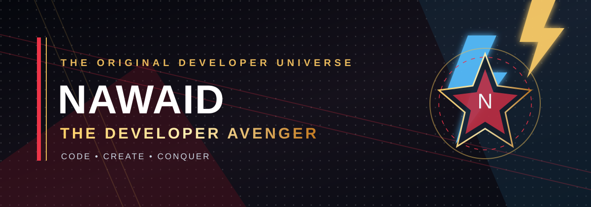
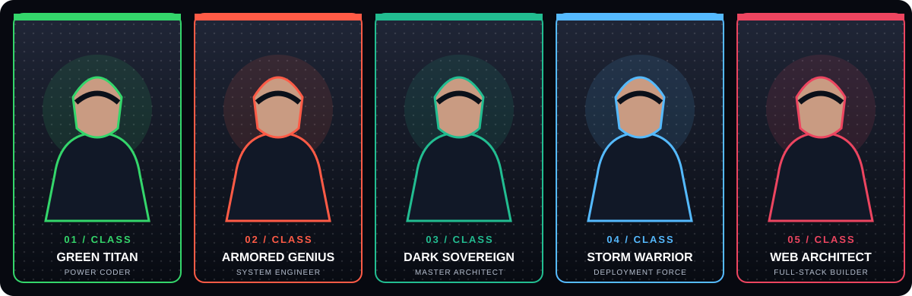

**ONE DEVELOPER · FIVE HERO IDENTITIES · ONE MISSION**

---

## ⚔️ THE HERO INITIATIVE

<table>
<tr>
<td align="center" width="50%">

### 🟢 THE GREEN TITAN

**POWER CODER**  
Strength · Persistence · Problem solving

</td>
<td align="center" width="50%">

### 🔴 THE ARMORED GENIUS

**SYSTEM ENGINEER**  
Engineering · Debugging · Building

</td>
</tr>
<tr>
<td align="center" width="50%">

### 🟩 THE DARK SOVEREIGN

**MASTER ARCHITECT**  
AI systems · Architecture · Strategy

</td>
<td align="center" width="50%">

### ⚡ THE STORM WARRIOR

**DEPLOYMENT FORCE**  
Learning · Energy · Shipping

</td>
</tr>
</table>

### 🕸️ THE WEB ARCHITECT

**FULL-STACK BUILDER**

---

## 🛰️ MISSION BRIEFING

I'm **Nawaid**, building practical software experiences around web development, AI and automation. I enjoy turning ideas into useful products, learning modern tools and improving systems one release at a time.

| Mission file | Current objective |
|---|---|
| 🚀 Featured build | **Nawshum** — AI-powered job application workflows |
| 🧠 Research lab | AI, automation, APIs and MCP |
| 🛠️ Engineering bay | Python, JavaScript, TypeScript, React, SQL |
| 🎯 Prime directive | Build useful things. Keep learning. Ship improvements. |

---

## 🧰 THE ARSENAL

---

## 📡 COMMAND CENTER · LIVE GITHUB INTELLIGENCE

---

## 🚀 CLASSIFIED PROJECTS

**NAWSHUM** — AI-powered job-application assistant focused on CV tailoring, job matching and application workflows.

---

### TRANSMISSION OPEN

**“Code is the weapon. Curiosity is the superpower.”**

